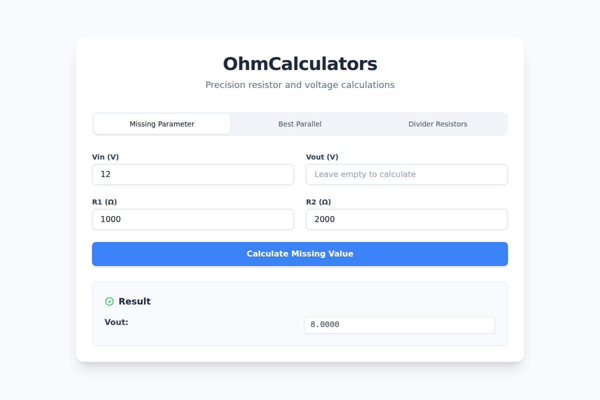

<div align="center">

# ⚡ OhmCalculators

**Precision resistor calculations, optimal E24 parallel combination finder, and voltage divider calculators with a modern FastAPI web interface.**

[](https://www.python.org/)
[](https://fastapi.tiangolo.com/)
[](https://tailwindcss.com/)
[](https://astral.sh/uv)
[](https://docs.pytest.org/)
[](LICENSE)

<br />

[Features](#-features) •
[Web Interface](#-web-interface) •
[Python API / CLI](#-cli--python-library-usage) •
[Project Architecture](#-project-architecture) •
[Quickstart](#-getting-started) •
[Testing](#-testing--quality)

</div>

---

## 📖 Overview

**OhmCalculators** is an electrical engineering calculation suite designed for circuit designers, embedded systems engineers, and hobbyists. It computes resistor networks based on the international **E24 resistor series** standard (1.0Ω to 9.1MΩ).

It provides two flexible interfaces:
1. 🌐 **FastAPI + Alpine.js Web Application**: A responsive single-page visual calculator with interactive tabs and instant results.
2. 💻 **CLI & Standalone Python Library**: Scriptable modules and terminal tools for automated circuit design pipelines.

---

## 📸 Web Interface

<div align="center">
  
</div>

The modern web application provides three dedicated calculation modes:
- 🔍 **Missing Parameter**: Enter any 3 parameters ($V_{in}$, $V_{out}$, $R_1$, or $R_2$) to solve for the 4th, with division-by-zero protection.
- ⚡ **Best Parallel**: Specify any target resistance (e.g., `4k7`, `500`) to find the two closest standard E24 resistors in parallel minimizing absolute error.
- 📐 **Divider Resistors**: Input input voltage, desired output voltage, and maximum allowable current to compute optimal E24 resistor pairs.

---

## 🚀 Features

| Capability | Module | Description |
|:---|:---|:---|
| **Voltage Divider Formula** | [`lib/voltage_divider_calculations.py`](lib/voltage_divider_calculations.py) | Full bidirectional solver with parameter count and zero-denominator validation |
| **E24 Standard Series** | [`lib/e24_resistor_values.py`](lib/e24_resistor_values.py) | Generator yielding standard logarithmic E24 resistor values across 6 decades |
| **Resistor Shorthand** | [`lib/common.py`](lib/common.py) | Formats numbers to standard engineering notation (`4.7k`, `10M`, `10R`) |
| **Parallel Pair Optimizer**| [`closest_parallel_resistors.py`](closest_parallel_resistors.py) | Iterative optimization algorithm finding the closest parallel resistor match |
| **Voltage Divider Pair Finder**| [`voltage_divider_resistors_calculator.py`](voltage_divider_resistors_calculator.py) | Determines optimal $R_1$ and $R_2$ conforming to maximum circuit current |
| **REST API & Web App** | [`src/main.py`](src/main.py) | High-performance FastAPI backend with Pydantic request models |

---

## 🏗️ Project Architecture

```
OhmCalculators/
├── docs/                            # Documentation assets
│   └── images/
│       └── preview.png              # UI showcase screenshot
├── lib/                             # Core electrical calculation modules
│   ├── common.py                    # Metric shorthand conversion utilities (k, M, G, R)
│   ├── e24_resistor_values.py       # E24 logarithmic resistor series generator
│   └── voltage_divider_calculations.py # Bidirectional voltage divider math solver
├── src/                             # FastAPI Web Application & REST API
│   ├── models/
│   │   └── requests.py              # Pydantic schema validation for calculation requests
│   ├── routes/
│   │   └── api.py                   # REST endpoints (/calculate-missing, /best-parallel, etc.)
│   ├── services/
│   │   └── calculator.py            # Service adapter layer linking routes to lib logic
│   ├── static/
│   │   ├── css/styles.css           # Custom styling and toast notification transitions
│   │   ├── js/app.js                # Alpine.js reactive state manager and toast controller
│   │   └── templates/
│   │       └── index.html           # Tailwind CSS responsive single-page web UI
│   └── main.py                      # FastAPI application entrypoint with Jinja2 mounting
├── tests/                           # Automated test suite
│   └── test_calculator.py          # Pytest unit and API integration tests
├── closest_parallel_resistors.py    # Standalone CLI tool: parallel resistor optimizer
├── voltage_divider_resistors_calculator.py # Standalone CLI tool: voltage divider designer
├── pyproject.toml                   # Project metadata and uv dependency definitions
└── LICENSE                          # MIT License
```

---

## 💻 CLI & Python Library Usage

### 1. Python Library Usage

```python
from lib.voltage_divider_calculations import voltage_divider_calculations
from closest_parallel_resistors import find_best_parallel_combination
from lib.common import convert_to_shorthand

# Calculate missing input voltage
vin = voltage_divider_calculations(vout=5.0, r1=10000, r2=10000)
print(f"Vin: {vin} V")  # Vin: 10.0 V

# Find closest parallel E24 resistors for 4700 ohms
r1, r2, error = find_best_parallel_combination(4700.0)
print(f"R1: {convert_to_shorthand(r1)}, R2: {convert_to_shorthand(r2)} (Error: {error:.2f}Ω)")
```

### 2. Standalone CLI Tools

```bash
# Find optimal parallel resistor combination
python3 closest_parallel_resistors.py

# Calculate voltage divider resistors with current constraints
python3 voltage_divider_resistors_calculator.py
```

---

## 🚀 Getting Started

### Prerequisites
- Python 3.10+
- Recommended package manager: [`uv`](https://docs.astral.sh/uv/)

### Installation

1. **Clone the repository**:
   ```bash
   git clone https://github.com/CFMVCarlos/OhmCalculators.git
   cd OhmCalculators
   ```

2. **Sync dependencies using `uv`**:
   ```bash
   uv sync
   ```

3. **Launch the Web Server**:
   ```bash
   uv run uvicorn src.main:app --host 0.0.0.0 --port 8000 --reload
   ```
   Open [http://localhost:8000](http://localhost:8000) in your browser. Interactive API documentation is available at [http://localhost:8000/docs](http://localhost:8000/docs).

---

## 🧪 Testing & Quality

Run the automated test suite covering calculation logic and API endpoints:

```bash
PYTHONPATH=. uv run pytest
```

All 7 test cases pass:
- ✅ Bidirectional voltage divider solver validation ($V_{in}$, $V_{out}$, $R_1$, $R_2$).
- ✅ Negative resistance and division-by-zero boundary error handling.
- ✅ Resistor shorthand notation and string conversions (`4k7`, `10M`, `10R`).
- ✅ E24 parallel combination approximation.
- ✅ FastAPI route responses and frontend template rendering.

---

## 📄 License

This repository is licensed under the **MIT License**. See the [LICENSE](LICENSE) file for complete details.

---

<div align="center">
  <sub>Maintained by <a href="https://github.com/CFMVCarlos">Carlos Valente</a>.</sub>
</div>